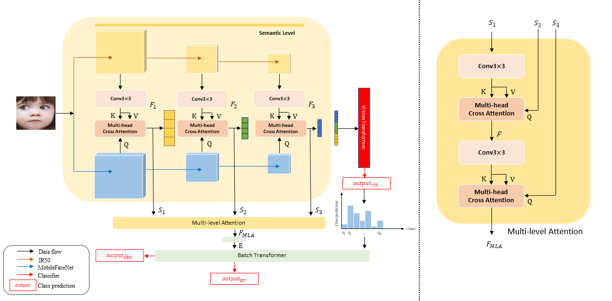

# Batch Transformer: Look for Attention in Batch 



Facial expression recognition (FER) has received
considerable attention in computer vision, with “in-the-wild”
environments such as human-computer interaction. However,
FER images contain uncertainty such as occlusion, low resolution,
pose variation, illumination variation, and subjectiveness, which
includes some expressions that do not match the target label.
Thus, little information is obtained from a noisy single image and
is not trusted. It would extremely degrade the performance of the
FER task. To address this issue, we propose a batch transformer
(BT) to prevent overfitting in noisy data and extract trustworthy
information by training information reflected features of several
images in a batch rather than information from a single image.
Additionally, we propose a class batch attention (CBA) to obtain
trustworthy information by reflecting the class prediction of
images with similar features. We propose multi- level attention
(MLA) to prevent overfitting the specific features by capturing
correlations between each level. In this paper, we present a
batch transformer network (BTN) combined the above proposals.
Experimental results on various FER datasets show that the
proposed BTN consistently outperforms the state-of- the-art in
FER datasets. Representative results demonstrate the promise of
the proposed BTN for FER.
### Preparation
- Preparing Data
  
  As an example, assume we wish to run RAF-DB. We need to make sure it have a structure like following:

	```
	- data/raf-db/
		 train/
		     train_00001_aligned.jpg
		     train_00002_aligned.jpg
		     ...
		 valid/
		     test_0001_aligned.jpg
		     test_0002_aligned.jpg
		     ...
	```

- Preparing Pretrained Models
  
	The following table provides the pre-trained checkpoints used in this paper. Put entire `pretrain` folder under `models` folder.

	<table><tbody>
	<!-- START TABLE -->
	<!-- TABLE HEADER -->
	<th valign="bottom">pre-trained checkpoint</th>
	<th valign="bottom">ownCloud</th>
	<!-- TABLE BODY -->
	<tr><td align="left">ir50</td>
	<td align="center"><a href="https://hcirlabserver.seoultech.ac.kr/dataset/s/qhixhxlOlBDAz7V">download</a></td>
	</tr>
	<tr><td align="left">mobilefacenet</td>
	<td align="center"><a href="https://hcirlabserver.seoultech.ac.kr/dataset/s/fyJskvBJPBGS9aZ">download</a></td>
	</tbody></table>

### Checkpoints
The following table provides POSTER V2 checkpoints in each dataset.

<table><tbody>
<!-- START TABLE -->
<!-- TABLE HEADER -->
<th valign="bottom">dataset</th>
<th valign="bottom">top-1 acc</th>
<th valign="bottom">ownCloud</th>

<!-- TABLE BODY -->
<tr><td align="left">RAF-DB</td>
<th valign="bottom">92.54</th>
<td align="center"><a href="https://hcirlabserver.seoultech.ac.kr/dataset/s/wYXSkGzB20YFWLB">download</a></td>
<tr><td align="left">AffectNet (7 cls)</td>
<th valign="bottom">67.60</th>
<td align="center"><a href="https://hcirlabserver.seoultech.ac.kr/dataset/s/OfmdcblMqgmoW62">download</a></td>
<tr><td align="left">AffectNet (8 cls)</td>
<th valign="bottom">63.77</th>
<td align="center"><a href="https://hcirlabserver.seoultech.ac.kr/dataset/s/5fxIhmlrnN6jhNB">download</a></td>
</tbody></table>


### Test

You can evaluate our model on RAF-DB dataset by running:

```
python main.py --data path/to/dataset --evaluate checkpoint/RAFDB92.54.pth
```

You can evaluate our model on AffectNet (7 cls) dataset by running:

```
python main.py --data path/to/dataset --evaluate checkpoint/AffectNet7_67.60pth
```

You can evaluate our model on AffectNet (8 cls) dataset by running:
```
python main_8.py --data path/to/dataset --evaluate checkpoint/AffectNet8_64.29.pth
```

### Train
You can train BTN on RAF-DB dataset by running as follows:
```
python main.py --data "absolute path of raf-db dataset" --data_type RAF-DB --lr 2e-5 --batch-size 64 --epochs 300 --gpu 0
```
You can train BTN on AffectNet (7 cls) dataset by running as follows:
```
python main.py --data "absolute path of affectnet7 dataset" --data_type AffectNet-7 --lr 0.8e-6 --batch-size 144 --epochs 100 --gpu 0
```
You can train BTN on AffectNet (8 cls) dataset by running as follows:
```
python main_8cls.py --data "absolute path of affectnet8 dataset" --lr 1e-6 --batch-size 144 --epochs 100 --gpu 0
```
You can continue your training by running:
```
python main.py --data "absolute path of raf-db dataset" --resume checkpoint/RAFDB92.54.pth
```

## Acknowledgments

This research was supported by the MSIT (Ministry of Science and ICT),
Korea, under the ITRC (Information Technology Research Center) support
program (IITP-2023-RS-2022-00156295) supervised by the IITP (Institute
for Information Communications Technology Planning Evaluation).

Author Myung Beom Her is really grateful to his supervisor, ji-Hyeong Han, for guiding him to the right direction.  
And He is really grateful to Jisu Jeong for discussing with him.
