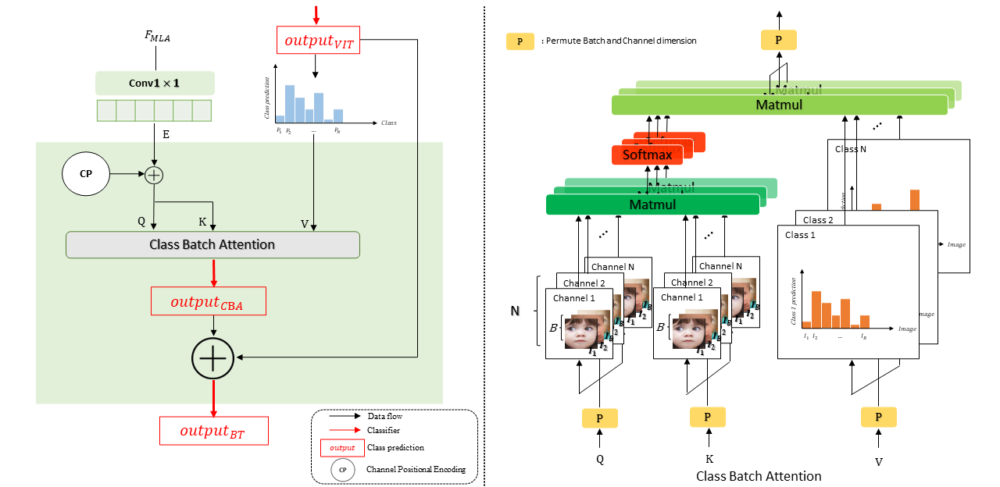
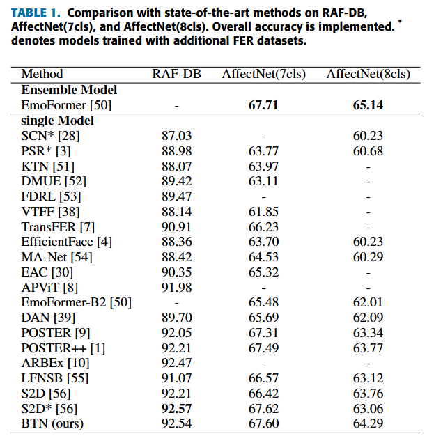

# Batch Transformer: Look for Attention in Batch 

## 📰 News
**[2025.10.29]** Batch Transformer is accepted for IEEE ACCESS <br>

## ✨ Overview

Facial expression recognition (FER) has received considerable attention in computer vision, with “in-the-wild” environments such as human-computer interaction. 
However, FER images contain uncertainties such as occlusion, low resolution, pose variation, illumination variation, and subjectivity, which include some expressions that do not match the target label.
Consequently, minimal information is obtained from a noisy single image, making it unreliable. 
This can significantly degrade the performance of the FER task. 
To address this issue, we propose a batch transformer (BT), comprising the proposed class batch attention (CBA) module to prevent overfitting in noisy data and to extract trustworthy information by training on features reflected from several images in a batch, instead of information from a single image. 
We also propose multi-level attention (MLA) to prevent the overfitting of specific features by capturing the correlations between each level. 
In this paper, we present a batch transformer network (BTN) that combines the above proposals. 



```
class BatchTransformer(nn.Module):
    def __init__(self,
                 channel,
                 ):
        factory_kwargs = {'device': None, 'dtype': None}
        super().__init__()
        self.pos_encoder = ChannelPositionalEncoding(channel=channel)
        
    def forward(self, query,key,value):

        q,k = self.pos_encoder(query,key) #B,C,49
        output_CBA = ClassBatchAttention(q,k,value)
        output_BT = output_CBA + value

        return output_CBA, output_BT
    
def ClassBatchAttention(q,k,value):

    #query :B,C,E -> 1,C,B,E
    q = q.contiguous().transpose(0,1).unsqueeze(0) #1, C, B, 49
    k = k.contiguous().transpose(0,1).unsqueeze(0)

    #value :B,C -> C,B,1
    v = value.unsqueeze(1) #B, 1, C
    v = v.contiguous().transpose(0,-1)#C,1,B
    v = v.contiguous().transpose(-2,-1)#C,B,1

    _,C,B,_ = q.shape #1, C, B, 49
    q_scaled = q / math.sqrt(C)
    attn_output_weights = q_scaled @ k.transpose(-2, -1)#1,C,B,B
    attn_output_weights = torch.softmax(attn_output_weights, dim=-1) #1,C,B,B
    attn_output_weights = attn_output_weights.contiguous().view(C,B,B) #C,B,B

    attn_output = torch.bmm(attn_output_weights, v) #C,B,1
    attn_output = attn_output.contiguous().view(C, B)#C,B
    attn_output = attn_output.transpose(-1,-2) #B,C
    return attn_output
```
[BatchTransformer.py](/models/BatchTransformer.py)

## 🚀 Main Results

### ✨ Static Facial Expression Recognition



## 🔨 Installation
Run the following command to make virtual environments
```bash
conda create -n BTN python=3.7.16
conda activate BTN
pip install -r requirements.txt
```

## ➡️ Data Preparation

- Preparing Data
  
  As an example, assume we wish to run RAF-DB. We need to make sure it have a structure like following:
   ```
	- data/raf-db/
		 train/label(ex., 1,2,...,7)/
		     train_00001_aligned.jpg
		     train_00002_aligned.jpg
		     ...
		 test/label(ex., 1,2,..,7)/
		     test_0001_aligned.jpg
		     test_0002_aligned.jpg
		     ...
	```

- Preparing Pretrained Models
  
	The following table provides the pre-trained checkpoints used in this paper. Put entire `pretrain` folder under `models` folder and modify the `checkpoint path` in `BTN_7cls.py` and `BTN_8cls.py` under `models`.
	ex)`face_landback_checkpoint = torch.load(r'path/to/mobilefacenet checkpoint')`, and `ir_checkpoint = torch.load(r'path/to/ir50 checkpoint')`.
	<table><tbody>
	<!-- START TABLE -->
	<!-- TABLE HEADER -->
	<th valign="bottom">pre-trained checkpoint</th>
	<th valign="bottom">ownCloud</th>
	<!-- TABLE BODY -->
	<tr><td align="left">ir50</td>
	<td align="center"><a href="https://drive.google.com/file/d/1KZy3qG3S4mmn1bnABme0JJA0X16AyaYL/view?usp=drive_link">download</a></td>
	</tr>
	<tr><td align="left">mobilefacenet</td>
	<td align="center"><a href="https://drive.google.com/file/d/167fDe4iBJAsECB4jAW_IoSDHW2tOAV3j/view?usp=drive_link">download</a></td>
	</tbody></table>

### Checkpoints
The following table provides BTN checkpoints in each dataset.

<table><tbody>
<!-- START TABLE -->
<!-- TABLE HEADER -->
<th valign="bottom">dataset</th>
<th valign="bottom">top-1 acc</th>
<th valign="bottom">ownCloud</th>

<!-- TABLE BODY -->
<tr><td align="left">RAF-DB</td>
<th valign="bottom">92.54</th>
<td align="center"><a href="https://drive.google.com/file/d/1nrvrjOmkQzEZyniASmXCkvp8iMaJZsjj/view?usp=drive_link">download</a></td>
<tr><td align="left">AffectNet (7 cls)</td>
<th valign="bottom">67.60</th>
<td align="center"><a href="https://drive.google.com/file/d/1Pbu7JOuGNiElYvOiiGCbn_XSAJ2d6W95/view?usp=drive_link">download</a></td>
<tr><td align="left">AffectNet (8 cls)</td>
<th valign="bottom">64.29</th>
<td align="center"><a href="https://drive.google.com/file/d/1RGXr20tr_ruDvkC8Fiw2cFaGU8TsWfT6/view?usp=drive_link">download</a></td>
</tbody></table>


### Test

You can evaluate our model on RAF-DB dataset by running:

```
python main.py --data path/to/dataset --evaluate checkpoint/RAFDB92.54.pth
```

You can evaluate our model on AffectNet (7 cls) dataset by running:

```
python main.py --data path/to/dataset --evaluate checkpoint/AffectNet7_67.60pth
```

You can evaluate our model on AffectNet (8 cls) dataset by running:
```
python main_8.py --data path/to/dataset --evaluate checkpoint/AffectNet8_64.29.pth
```

### Train
You can train BTN on RAF-DB dataset by running as follows:
```
python main.py --data path/to/dataset --data_type RAF-DB --lr 2e-5 --batch-size 64 --epochs 300 --gpu 0
```
You can train BTN on AffectNet (7 cls) dataset by running as follows:
```
python main.py --data path/to/dataset --data_type AffectNet-7 --lr 0.8e-6 --batch-size 144 --epochs 100 --gpu 0
```
You can train BTN on AffectNet (8 cls) dataset by running as follows:
```
python main_8cls.py --data path/to/dataset --lr 1e-6 --batch-size 144 --epochs 100 --gpu 0
```
You can continue your training by running:
```
python main.py --data path/to/dataset --resume checkpoint/RAFDB92.54.pth
```

## ☎️ Contact 

If you have any questions, please feel free to reach me out at `gblader@naver.com`.

## 👍 Acknowledgements

This work was supported by the IITP(Institute of Information Communications Technology Planning Evaluation)-ITRC(Information
Technology Research Center) grant funded by the Korea government(Ministry of Science and ICT)(IITP-2025-RS-2022-00156295)

